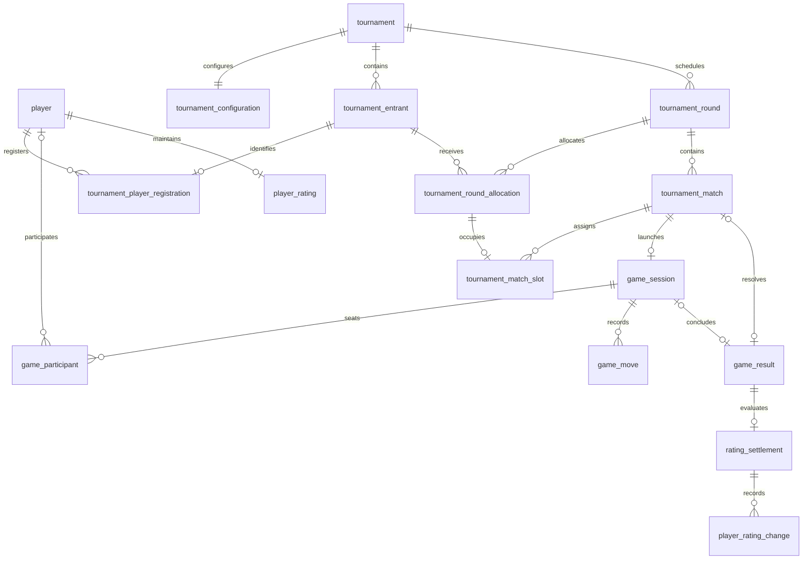

# Relationship and invariant reference

## Existing ownership

`player` remains the identity root. Its unique profile/preference children are
optional one-to-one records; access logs are one-to-many. `teamstate` is permanent
membership, while `tourteamstate` is a tournament roster. Neither is repurposed
as individual registration. Existing history/count tables are summaries, not
authoritative event or Elo ledgers.

## New table map

| Table | Primary ownership / important uniqueness |
| --- | --- |
| `auth_session` | Optional player FK, opaque case-sensitive session PK |
| `tournament_format` | Stable code PK, unique backend strategy key |
| `tournament_configuration` | Tournament PK/FK, immutable once frozen |
| `tournament_entrant` | Tournament FK, unique non-null seed per tournament |
| `tournament_player_registration` | Entrant PK/FK, unique tournament/player |
| `tournament_round` | Tournament FK, unique tournament/round number |
| `tournament_round_allocation` | Same-tournament entrant/round, unique round/entrant |
| `tournament_match` | Same-tournament round, unique round/board number |
| `tournament_match_slot` | Scoped match + MATCH allocation, unique match/color and allocation |
| `tournament_opponent_pair` | Both actual match slots, canonical unique tournament/opponent pair |
| `game_session` | Optional unique tournament fixture, otherwise quick play |
| `game_participant` | Session/color, optional player, exact tournament slot and registration |
| `game_move` | Same-session participant, unique session/ply sequence |
| `game_command_receipt` | Same-session participant, unique accepted command identity |
| `game_result` | Unique match and/or session, context and score checks |
| `rating_policy` | Immutable versioned policy catalog |
| `player_rating` | Player PK/FK, current projection from versioned history |
| `rating_settlement` | Unique result decision, staged PENDING then APPLIED |
| `player_rating_change` | Actual session participant, unique settlement/player/color and player history version |
| `tournament_final_standing` | Scoped entrant, duplicate ranks intentionally allowed |
| `scheduled_action` | Typed FK targets, unique dedupe key, valid claim leases |
| `outbox_event` | Scoped entity references, monotonic delivery sequence |
| `schema_migration` | Checksummed ordered DDL journal |

Composite unique keys containing a primary ID are intentional. They allow
MySQL 8.4 to reference the complete ownership tuple, not a nonunique index prefix.
Foreign keys use default restrictive actions. There are no cascading historical
deletes or `foreign_key_checks=0` deployment steps.

## Enforced in SQL

- Cross-tournament entrant/round/match/slot references fail composite FKs.
- Game participants must be the assigned account/color and cannot omit their
  tournament context to bypass nullable composite FKs.
- Results cannot bind to another session/fixture/context.
- Assigned players and published colors cannot be edited or deleted.
- Fixture publication requires both colors and the unique opponent-pair record.
- Round publication requires allocations for every seeded entrant and no draft
  fixtures or orphan MATCH allocations.
- Fixed schedules/configuration cannot be altered once frozen. Configuration
  freeze validates the complete round count, durations, gaps and overall bounds.
- Full-point bye generated unique keys allow only one per round and no repeats
  for an entrant. A pre-start withdrawal can replace its pending bye with zero.
- Move inserts lock the session and require its next sequence and side. Accepted
  journals/receipts/results/rating changes are immutable.
- Results enforce exact outcome/point combinations and fixed deadline draws.
- An Elo settlement cannot become APPLIED until both changes are zero-sum and
  both current profiles have advanced. Unrated decisions cannot have changes.
- Match/game finalization requires the authoritative result and an applied
  rating decision; an unmatched session cannot be silently closed.
- Player rating updates require their pending history entry and matching outcome
  counters. Direct rating resets/deletion are prohibited.
- Existing team fixtures cannot cross tournaments; board players must belong to
  the opposing rosters. Legacy winners and move actors must be assigned sides.

## Enforced by future application transactions

SQL does not have deferrable cross-row assertions at transaction commit. It can
therefore hold staged draft fixtures or pending settlements. A writer that
commits halfway violates the application contract even if every individual row
is valid. `v_schema_integrity_issues` diagnoses such committed inconsistencies.

The following remain explicit service responsibilities:

- Authentication, authorization, password hashing and account eligibility.
- Capacity checks under the parent tournament lock and actual registration time.
- Swiss search, score grouping, float preferences, feasibility/search budgets,
  bye eligibility after unplayed wins, lowest-standing bye selection, odd-field
  validation, and the no-third-consecutive-played-color rule.
- Legal chess moves and engine version compatibility. SQL validates sequencing
  and identity, not piece movement or checkmate.
- Current socket presence, multi-tab counts, boot epochs and grace-window policy.
- Deadline/no-show decisions, including generation checks for stale jobs.
- Elo expectation/rounding mathematics and eligibility interpretation by policy.
- Exact score/tiebreak calculation, winner selection and final ranking meaning.
- Idempotent data imports, cached statistics and event delivery retries.

No team entrant subtype or team board-scoring algorithm is introduced. Existing
team tables remain separate historical structures until that feature is built.
